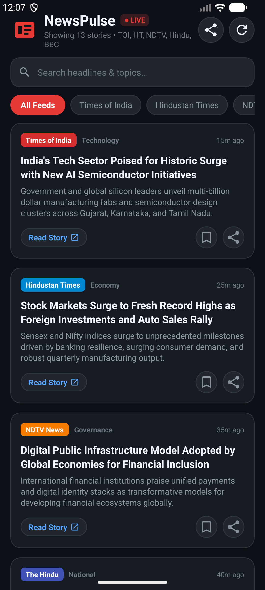

# NewsPulse - Real-Time Multi-Feed News Aggregator & Sharing App

A modern, responsive Android news application built in **Kotlin** and **Material Design 3**. Aggregates live breaking stories and updates from major news networks including **Times of India**, **Hindustan Times**, **NDTV**, **The Hindu**, and **BBC News**, featuring one-tap article sharing and daily news digest broadcasting via native Android Share Sheets.



---

## 🚀 Key Features

- **📡 Multi-Channel RSS Aggregation**:
  - Live feeds from **Times of India**, **Hindustan Times**, **NDTV**, **The Hindu**, and **BBC News**.
  - Background concurrent multi-threaded fetching with network timeout protection.
  - Offline-first cache in SQLite so breaking stories are immediately readable without waiting.
- **🏷️ Channel Branding & Filtering**:
  - Distinct channel badges: Times of India (Crimson), Hindustan Times (Royal Blue), NDTV (Flame Orange), The Hindu (Indigo), BBC (Maroon).
  - Quick channel filter pills (*All Feeds*, *Times of India*, *Hindustan Times*, *NDTV*, *The Hindu*, *BBC News*, *Saved*).
- **📤 Dual Sharing Modes (Native Share Sheet)**:
  - **Single Article Share**: Share headline, summary, channel tag, and direct article link to WhatsApp, Slack, Telegram, Twitter, or Email (`Intent.ACTION_SEND`).
  - **Daily News Digest**: One-tap share in top app bar formats the top 5 breaking headlines across all networks into a daily news digest broadcast.
- **📖 Article Detail Reader Modal**:
  - Tap any card to open a reader view with full headline, detailed summary, "Read on Website" button, and direct Share button.
- **🔍 Instant Live Search**:
  - Filter stories by keywords, topics, or organizations in real-time with an instant clear button.
- **🔖 Bookmark & Saved Stories**:
  - One-tap bookmarking to save stories locally in SQLite for reading later.
- **🔄 Pull to Refresh**:
  - Android `SwipeRefreshLayout` support to fetch breaking updates anytime.

---

## 🛠️ Tech Stack & Architecture

- **Language**: Kotlin
- **Build System**: Gradle Kotlin DSL (`build.gradle.kts`)
- **Android Gradle Plugin**: 9.0.1
- **Target / Compile SDK**: 36.1 | **Min SDK**: 24 (Android 7.0+)
- **Architecture**: Single-Activity with ViewBinding
- **Database**: Local SQLite via `SQLiteOpenHelper`
- **RSS Parsing**: Fault-tolerant `XmlPullParser` with HTML entity decoding and date parsing
- **UI Components**: Material 3 CardView, ChipGroup horizontal scrolling, SwipeRefreshLayout

---

## 🗄️ Database Schema

```sql
CREATE TABLE articles (
    id INTEGER PRIMARY KEY AUTOINCREMENT,
    title TEXT UNIQUE NOT NULL,
    description TEXT,
    link TEXT,
    source TEXT NOT NULL,
    category TEXT NOT NULL,
    pub_date INTEGER NOT NULL,
    image_url TEXT,
    is_bookmarked INTEGER DEFAULT 0
);
```

---

## 📦 How to Build & Run

### Prerequisites
- Android SDK (API 34+)
- JDK 17 or JDK 21

### Building the APK
```bash
# Clone the repository
git clone https://github.com/rajeevksofficial/NewsPulseApp.git
cd NewsPulseApp

# Build Debug APK
./gradlew assembleDebug
```

Output APK will be generated at:
`app/build/outputs/apk/debug/app-debug.apk`

---

## 📄 License
This project is open source and available under the [MIT License](LICENSE).
